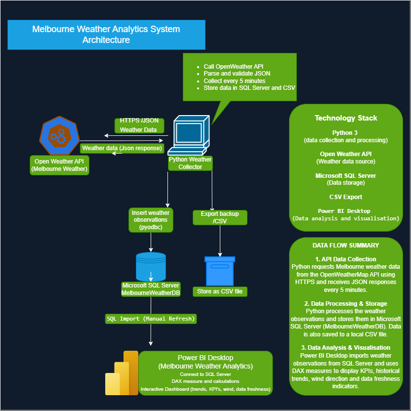

# Melbourne Weather Analytics

## Project Overview

Melbourne Weather Analytics is an end-to-end data engineering and business intelligence project that collects, stores and visualises weather observations for Melbourne, Australia.

The system integrates the OpenWeatherMap API, Python, Microsoft SQL Server and Power BI Desktop to demonstrate API integration, automated data collection, database management and interactive data visualisation.

A Python weather collector retrieves weather observations at five-minute intervals and stores them in a SQL Server database, with a separate CSV export.

Power BI Desktop imports the stored observations to provide historical weather trends, key performance indicators (KPIs), wind direction analytics and data freshness monitoring.

## Project Objectives

- Integrate an external weather API using Python.
- Automate weather data collection at five-minute intervals.
- Store structured weather observations in Microsoft SQL Server.
- Maintain a local CSV export.
- Build an interactive Power BI dashboard using DAX measures.
- Monitor the freshness of collected data.
- Demonstrate an end-to-end data pipeline suitable for a technical portfolio.

## System Architecture

The Melbourne Weather Analytics system uses a Python-based
data collection pipeline to retrieve, process and store
weather observations.

The architecture consists of:

1. **OpenWeatherMap API** — Provides Melbourne weather data
   through HTTPS requests and JSON responses.

2. **Python Weather Collector** — Retrieves and processes
   weather observations every five minutes.

3. **Microsoft SQL Server** — Stores observations in the
   MelbourneWeatherDB database.

4. **CSV Export** — Maintains a separate local copy of
   the collected weather data.

5. **Power BI Desktop** — Imports observations from SQL
   Server and provides interactive analytics and reporting.

### Architecture Diagram

## Python Weather Data Collection

The project uses a Python script (`weather_collector.py`)
to collect weather observations for Melbourne, Australia.

### Data Collection Process

1. Connects to the OpenWeatherMap API using HTTPS.
2. Retrieves current weather conditions in JSON format.
3. Extracts weather measurements from the API response.
4. Processes the observations using Python.
5. Inserts weather observations into Microsoft SQL Server.
6. Saves observations to a local CSV file.
7. Repeats the collection process every five minutes.

### Weather Measurements

The system collects the following measurements:

| Measurement | Description |
|---|---|
| Timestamp | Date and time of observation |
| Temperature | Air temperature in Celsius |
| Humidity | Relative humidity (%) |
| Sea Level Pressure | Atmospheric pressure (hPa) |
| Ground Level Pressure | Ground-level pressure (hPa) |
| Wind Speed | Wind speed (m/s) |
| Wind Direction | Wind direction in degrees |
| Wind Gust | Wind gust speed (m/s) |

### API Key Security

The OpenWeatherMap API key is supplied through an
environment variable rather than being stored directly
in the Python source code.

This reduces the risk of exposing credentials when
publishing the project to GitHub.

## Microsoft SQL Server Database

The project uses Microsoft SQL Server Express to store
weather observations collected by the Python script.

### Database Configuration

- **Database:** MelbourneWeatherDB
- **Table:** dbo.WeatherObservations
- **Database Engine:** Microsoft SQL Server Express
- **Python Connection Library:** pyodbc
- **Power BI Connection Mode:** Import

### Database Table Structure

| Column | Data Type | Description |
|---|---|---|
| ObservationID | INT IDENTITY | Unique observation identifier (Primary Key) |
| Timestamp | DATETIME2 | Date and time of observation |
| Temperature_Celsius | Numeric | Temperature in Celsius |
| Humidity_Percent | Numeric | Relative humidity percentage |
| Sea_Level_hpa | Numeric | Sea-level atmospheric pressure |
| Ground_Level_hpa | Numeric | Ground-level atmospheric pressure |
| Wind_Speed_mps | Numeric | Wind speed in metres per second |
| Wind_Deg | Numeric | Wind direction in degrees |
| Wind_Gust_mps | Numeric | Wind gust speed in metres per second |

### Data Storage Process

1. Python retrieves weather observations from OpenWeatherMap.
2. The observations are prepared for database insertion.
3. The pyodbc library connects Python to SQL Server.
4. Each observation is inserted into dbo.WeatherObservations.
5. SQL Server retains the observations for historical analysis.
6. Power BI imports the stored observations for reporting.

### Database Benefits

- Persistent storage of historical weather observations.
- Structured data suitable for querying and analysis.
- Integration between Python and Microsoft SQL Server.
- Support for historical trends and Power BI reporting.

## Power BI Dashboard

The Melbourne Weather Analytics dashboard was developed
using Microsoft Power BI Desktop.

It connects to the MelbourneWeatherDB SQL Server database
using Import mode to analyse historical weather observations.

### Dashboard Features

**Weather Monitoring KPIs**
- Latest Temperature (°C)
- Latest Humidity (%)
- Latest Wind Speed (m/s)
- Last Updated timestamp
- Wind Direction (°)
- Wind Compass Direction

**Historical Weather Analysis**
- Temperature trends
- Humidity trends
- Wind speed trends
- Interactive date-range slicer
- Maximum and minimum temperatures
- Total observations collected

**Data Freshness Monitoring**
- Calculates the age of the latest imported observation.
- CURRENT: Reading is 10 minutes old or less.
- STALE: Reading is more than 10 minutes old.
- CHECK TIME: Observation timestamp is in the future.
- NO DATA: No observation is available.
- Uses conditional formatting to display status colours.

### DAX Measures

Custom DAX measures were developed to:

1. Retrieve the latest weather observations.
2. Calculate maximum and minimum temperatures.
3. Count collected observations.
4. Convert wind direction degrees into compass directions.
5. Calculate minutes since the latest observation.
6. Determine data freshness status.
7. Apply dynamic colour formatting to status indicators.

### Data Refresh

Power BI Desktop currently uses manual refresh to import
updated observations from SQL Server.

The Python collector runs separately and is configured
to retrieve new weather observations every five minutes.

The data freshness indicator evaluates the age of the
latest observation loaded into Power BI. It does not
independently verify whether the Python collector is running.

### Dashboard Design

The dashboard uses a dark navy monitoring theme with
amber KPI values, rounded cards, interactive charts
and conditional formatting.

The layout was designed to present weather information
clearly and support quick interpretation of trends.

## Testing and Troubleshooting

The Melbourne Weather Analytics system was tested
throughout development to verify API connectivity,
database integration, data accuracy and dashboard
functionality.

### 1. OpenWeatherMap API Authentication

**Issue:**
The Python collector returned HTTP 401 Unauthorized.

**Cause:**
The API key environment variable was not correctly
configured in the active PowerShell session.

**Resolution:**
Configured OPENWEATHER_API_KEY with the valid API key
and restarted the collector.

**Result:**
Weather observations were successfully retrieved.

### 2. SQL Server Connectivity

**Issue:**
Connection configuration and certificate encryption
settings prevented successful database connectivity.

**Resolution:**
Configured the SQL Server Express instance and adjusted
the connection encryption settings for local development.

**Result:**
Python successfully inserted observations, and Power BI
connected to the SQL Server database.

### 3. Timestamp and Time Zone Validation

**Issue:**
An additional Power Query time zone adjustment caused
timestamps to display incorrectly.

**Cause:**
The Python collector was already recording local
Melbourne time.

**Resolution:**
Removed the unnecessary Power Query time adjustment.

**Result:**
Power BI displayed the expected observation timestamps.

### 4. DAX Wind Direction Calculation

**Issue:**
Changing the numeric wind direction measure to include
a degree symbol interfered with dependent calculations.

**Resolution:**
Retained the original numeric DAX measure and created
a separate formatted display measure.

**Result:**
Wind direction displayed correctly in degrees and
compass notation.

### 5. Data Freshness Monitoring

**Test:**
Verified the dashboard's data freshness indicator
against the latest imported observation timestamp.

**Result:**
The indicator displayed STALE for older observations
and CURRENT after importing a recent observation.

### 6. Dashboard Validation

The following features were tested:

- Latest weather KPI calculations.
- Temperature, humidity and wind speed charts.
- Interactive date-range filtering.
- Maximum and minimum temperature calculations.
- Observation count.
- Wind direction conversion.
- Conditional status formatting.
- Manual SQL Server data refresh.

### Testing Outcome

The system successfully demonstrated the complete
data pipeline from external API retrieval through
Python processing and SQL Server storage to
interactive Power BI reporting.

The Python collector requires an active running
process, and Power BI refresh is currently manual.

## Current Limitations

The Melbourne Weather Analytics project is a functional
local development prototype.

The current implementation has the following limitations:

- The Python weather collector must be started manually.
- Data collection stops when the collector is not running.
- SQL Server Express runs on a local Windows computer.
- Power BI Desktop requires manual data refresh.
- The dashboard does not provide continuous live updates.
- Observation timestamps are stored using local system time.

## Future Improvements

Potential enhancements include:

### 1. Automated Data Collection
Configure Windows Task Scheduler or a background service
to run the weather collector automatically.

### 2. Automated Dashboard Refresh
Explore Power BI Service and an on-premises data gateway
to support scheduled refreshes.

### 3. Cloud Database Integration
Migrate the local SQL Server database to a suitable
cloud-hosted database service.

### 4. Improved Error Handling
Implement structured logging, retry logic and
notifications for API or database failures.

### 5. Time Zone Management
Store timezone-aware UTC timestamps and convert
them to Melbourne time for reporting.

### 6. Advanced Weather Analytics
Extend the dashboard with historical comparisons,
weather anomaly detection and forecasting.

## Project Status

The initial implementation and dashboard development
are complete.

The system has been tested successfully for API
integration, Python data collection, SQL Server
storage and Power BI reporting.

Further enhancements are planned as future development
opportunities.
