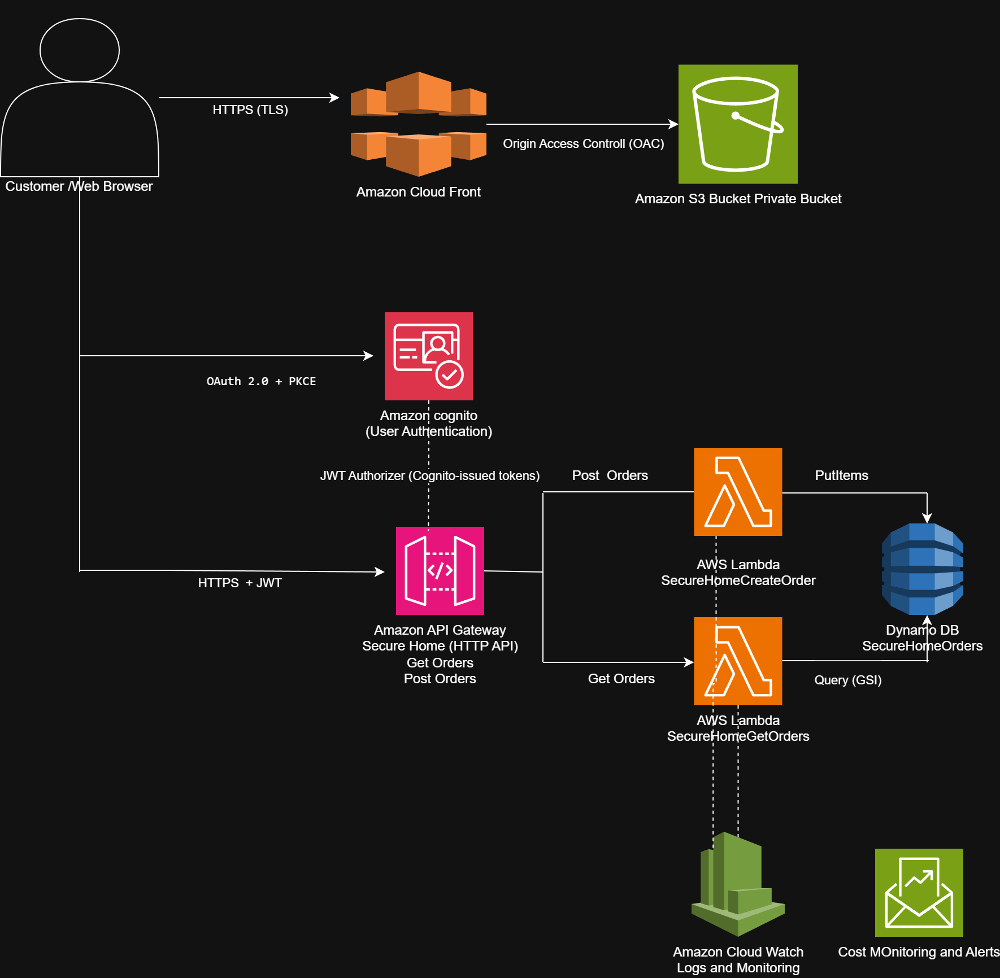

# SecureHome Cloud

**AWS Serverless E-Commerce Project**  
**Status:** Functional application — portfolio documentation in progress  
**AWS Region:** Asia Pacific (Melbourne), `ap-southeast-4`  
**Live website:** [Open SecureHome Cloud](https://d1khr8jeayvsgv.cloudfront.net/)

## About This Project

I built SecureHome Cloud to put the AWS skills I learned during my Diploma of Applied Technologies and AWS certification studies into practice.

Rather than building only a static website, I wanted to see how several AWS services work together in a real application. I chose a home-security online store because it gave me the opportunity to work with customer authentication, APIs, serverless computing and a database.

Customers can browse products, create an account, sign in, manage a shopping cart, place orders and view their order history.

## AWS Architecture

The application uses the following AWS services:

| AWS service | How I used it |
| --- | --- |
| Amazon S3 | Stores the website's HTML, CSS and JavaScript files in a private bucket. |
| Amazon CloudFront | Delivers the website over HTTPS and accesses S3 using Origin Access Control (OAC). |
| Amazon Cognito | Handles customer registration and sign-in using OAuth 2.0 Authorization Code Flow with PKCE. |
| Amazon API Gateway | Exposes protected HTTP API endpoints and validates JWT access tokens. |
| AWS Lambda | Runs the backend functions that create and retrieve orders. |
| Amazon DynamoDB | Stores customer orders and supports customer-specific queries. |
| Amazon CloudWatch | Provides Lambda logs for monitoring and troubleshooting. |
| AWS IAM | Controls permissions granted to AWS services and Lambda functions. |
| AWS Budgets | Monitors spending and provides budget alerts. |

### How the Application Works

1. A customer opens the website through CloudFront, which retrieves the frontend files from the private S3 bucket.
2. The customer registers or signs in using Cognito.
3. Cognito completes authentication using OAuth 2.0 with PKCE.
4. When the customer submits an order, the browser sends a request with a JWT access token to API Gateway.
5. API Gateway validates the token and invokes `SecureHomeCreateOrder`.
6. The Lambda function validates the order and writes it to DynamoDB.
7. When the customer selects **My Orders**, API Gateway invokes `SecureHomeGetOrders` to retrieve orders associated with that customer.

### API Endpoints

| Method | Endpoint | Purpose |
| --- | --- | --- |
| `POST` | `/orders` | Create an order for the signed-in customer. |
| `GET` | `/orders` | Retrieve the signed-in customer's order history. |

Both endpoints require authentication.

## Features I Implemented

### Customer Accounts

Customers can register, sign in and sign out through Amazon Cognito. I used the OAuth 2.0 Authorization Code Flow with PKCE for browser-based authentication.

### Shopping Cart

I built the shopping cart using JavaScript. Customers can add products, change quantities, remove items and see the total. The cart is stored in the browser's `localStorage` so it remains available after a page refresh.

### Order Processing

When a signed-in customer submits an order, the frontend sends an authenticated request to API Gateway. The `SecureHomeCreateOrder` Lambda function validates the request, generates an order ID and stores the order in DynamoDB.

### Order History

The **My Orders** panel displays previous purchases. The `SecureHomeGetOrders` Lambda function queries the DynamoDB Global Secondary Index `userId-createdAt-index` to retrieve orders associated with the authenticated customer.

## Security

Security was a major part of the project. I implemented the following controls:

- Kept the S3 website bucket private and used CloudFront OAC to access it.
- Delivered the website and API over HTTPS.
- Used Cognito for customer authentication and PKCE for the browser sign-in flow.
- Protected order API routes with JWT authorization.
- Used IAM roles to control access between AWS services.
- Associated orders with the authenticated customer's identity on the backend.
- Kept AWS credentials out of frontend source code.

### Testing Customer Access

I created a second customer account to test whether one customer could view another customer's orders. The second account could not retrieve the first account's orders.

I also tested a protected API endpoint without authentication and received an **HTTP 401 Unauthorized** response. These checks helped me understand why access controls must be enforced by the backend rather than just the website interface.

## Challenges I Encountered

### Cognito and API Gateway

Getting authentication working between Cognito and API Gateway took several attempts. I encountered issues with authorization scopes and protected routes. Resolving them helped me understand the difference between authenticating a user and authorizing an API request.

### DynamoDB

An early order-creation test failed because the data written by Lambda did not match the DynamoDB table's expected key structure. I investigated the error in CloudWatch logs and corrected the implementation.

### CloudFront Caching

I learned that uploading updated JavaScript to S3 does not always make the changes immediately visible through CloudFront. I used CloudFront invalidations while testing frontend updates.

### Frontend Development

The shopping cart and order-history interface required several rounds of debugging. I worked through JavaScript event handling, cart state, authentication state and displaying order information correctly.

## Testing

I tested the application throughout development. The results below describe manual functional and security checks, not an automated test suite.

| Test | Result |
| --- | --- |
| Website loads through CloudFront | Passed |
| Product catalogue displays | Passed |
| Add, remove and update shopping-cart items | Passed |
| Customer registration | Passed |
| Customer sign-in and sign-out | Passed |
| Authenticated order submission | Passed |
| Order stored in DynamoDB | Passed |
| Customer order history retrieved | Passed |
| Unauthenticated API request rejected | Passed — HTTP 401 |
| Customer accounts cannot access each other's orders | Passed |
| JavaScript syntax validation | Passed |

## Cost Management

I chose managed serverless services to avoid running dedicated servers continuously. I also configured AWS Budgets to monitor spending and provide alerts. Free Tier eligibility depends on the service, region and account, so I monitor usage rather than assuming the application is free to operate.

## What I Learned

Building SecureHome Cloud helped me move beyond studying AWS services individually and understand how they fit together in a working application. My main lessons included:

- Connecting Cognito authentication with API Gateway authorization.
- Designing DynamoDB access patterns using a Global Secondary Index.
- Using CloudWatch logs to troubleshoot Lambda errors.
- Securing S3 access through CloudFront OAC.
- Understanding how caching affects deployments.
- Testing backend access controls with separate customer accounts.
- Debugging interactions between frontend JavaScript and AWS services.

The biggest lesson was that building a cloud application involves more than configuring each service: the components must work together securely, and testing is essential.

## Future Improvements

Possible future improvements include payment processing, order-confirmation notifications, an administrative order-management interface, automated tests and a CI/CD pipeline. These are **not** part of the current implementation.

## Project Summary

SecureHome Cloud is part of my cloud and data technology portfolio. Building it has given me hands-on experience designing, deploying, securing and troubleshooting an AWS serverless application.

## Project Reports

I have documented the development of SecureHome Cloud in two reports:

- [Technical Report](reports/SecureHome-Cloud-Technical-Report.pdf) — A detailed account of the AWS architecture, implementation, testing, troubleshooting and lessons learned.

- [Project Case Study](reports/SecureHome-Cloud-Case-Study.pdf) — A shorter overview of the project, the challenges I encountered and the skills I developed.